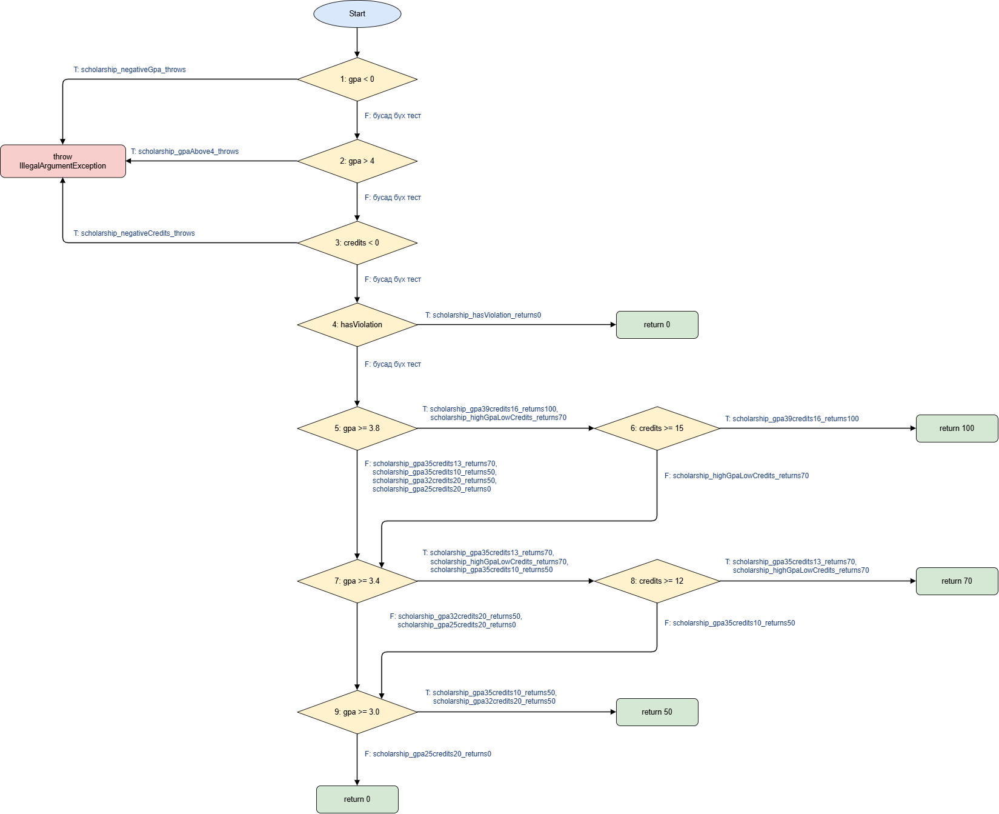

# Лаборатори №9 — Код хамралт: JaCoCo-гоор тестээ хөтлөх

**Оюутан:** С. Азжаргал  
**Оюутны код:** B232270052  
**Хичээл:** F.CSA313 — Программ хангамжийн чанарын баталгаа ба тест  
**Орчин:** Windows 11, PowerShell

---

## Орчны хувилбар

```bash
> java -version
openjdk version "17.0.20.1" 2026-08-18
OpenJDK Runtime Environment Temurin-17.0.20.1+1 (build 17.0.20.1+1)
OpenJDK 64-Bit Server VM Temurin-17.0.20.1+1 (build 17.0.20.1+1, mixed mode, sharing)
```

```bash
> mvn -version
Apache Maven 3.9.16 (2bdd9fddda4b155ebf8000e807eb73fd829a51d5)
Maven home: C:\Program Files\apache-maven-3.9.16
Java version: 17.0.20.1, vendor: Eclipse Adoptium, runtime: C:\Program Files\Eclipse Adoptium\jdk-17.0.20.101-hotspot
Default locale: en_US, platform encoding: Cp1252
OS name: "windows 11", version: "10.0", arch: "amd64", family: "windows"
```

---

## Төслийн бүтэц

```text
lab9-jacoco/
├── pom.xml
├── cfg.png / cfg.drawio                       # scholarship()-ийн CFG
├── src/main/java/mn/edu/must/sqat/ScholarshipCalculator.java
├── src/test/java/mn/edu/must/sqat/
│   ├── ScholarshipCalculatorTest.java         # Хэсэг A — Happy path тестүүд (5)
│   ├── ScholarshipCalculatorBranchTest.java   # Хэсэг B — Branch 100% хамралт (16)
│   ├── ScholarshipCalculatorLoopTest.java     # Хэсэг C — Давталтын заагийн тестүүд (4)
│   └── ScholarshipCalculatorBoundaryTest.java # Хэсэг D — Зааг утгын тестүүд (7 мөр)
└── results/
    ├── mvn-verify-A.txt, jacoco-A.csv
    ├── mvn-verify-B.txt, jacoco-B.csv
    ├── mvn-verify-C.txt
    ├── mvn-test-D-fail.txt
    └── mvn-verify-final.txt, jacoco-final.csv
```


## Хэсэг A — Happy Path Тестүүд ба Эхний Хэмжилт

Үндсэн хэвийн урсгалыг шалгах 5 тест бичсэн:
* `letterGrade(95) = "A"`
* `letterGrade(85) = "B"`
* `gpa([95, 85]) = 3.5`
* `scholarship(3.9, 16, false) = 100`
* `scholarship(3.5, 13, false) = 70`

### Хамралтын үр дүн (`results/jacoco-A.csv`):

| Хэмжүүр | Missed | Covered | Хамралт (%) |
| :--- | :---: | :---: | :---: |
| **Instruction** | 50 | 102 | 67.1% (102/152) |
| **Branch** | 21 | 20 | 48.8% (20/41) |
| **Line** | 10 | 15 | 60.0% (15/25) |
| **Method** | 0 | 4 | 100% (4/4) |

### Ажиглалт:
* **Шар ромботой мөрүүд:** `score < 0 || score > 100`, `scores == null || scores.length == 0`, `gpa < 0 || gpa > 4 || credits < 0` зэрэг нийлмэл нөхцөлүүд болон `score >= 90`, `score >= 80`, `hasViolation`, `gpa >= 3.8 && credits >= 15`, `gpa >= 3.4 && credits >= 12`, `switch` мөрүүд хагас хамрагдсан. Happy path тестүүд эдгээр нөхцөлийн зөвхөн нэг талыг (хэвийн салааг) дайрсан байна.
* **Улаан мөрүүд:** Бүх `throw new IllegalArgumentException` алдааны замууд, `letterGrade`-ийн C/D/F салаанууд, `gpa`-ийн `switch`-ийн `"C"`, `"D"`, `default` (F) тохиолдлууд болон `scholarship`-ийн 50%, 0%-ийн буцаалтууд огт хамрагдаагүй үлдсэн. 

Өөрөөр хэлбэл, зөвхөн хэвийн урсгалыг шалгахад алдааны болон доод ангиллын замууд бүгд хамрагдалгүй үлддэг.

---

## Хэсэг B — CFG ба Branch 100% Хамралт



`cfg.png` дээр `scholarship()` функцийн хяналтын урсгалын графыг (CFG) харуулав:
* **9 шийдвэрийн зангилаа** (нийлмэл нөхцөлийн `||`, `&&` бүрийг тусдаа зангилаа болгосон)
* **18 салааны ирмэг** (ирмэг бүр дээр тухайн замыг дайрч буй тестийн методын нэрийг тэмдэглэсэн)

`ScholarshipCalculatorBranchTest` класт **16 шинэ тест** нэмсэн:
1. `letterGrade`-ийн 2 exception зам болон C/D/F үнэлгээнүүд.
2. `gpa`-ийн `null`, хоосон массив, 5 дүнгийн ангилал бүгд (`switch`-ийн `default` буюу F-г оруулаад).
3. `scholarship`-ийн `||` нөхцөл тус бүрийн үнэн утгад 3 тусдаа `assertThrows`, зөрчилтэй тохиолдол, голч хангасан ч кредит дутуу (`&&`-ийн баруун тал `false`) 2 тохиолдол, 50% ба 0%-ийн буцаалтууд.

**Тестийн тоо:** 100% хамралтад хүрэхэд нийт **21 тест** (A хэсгийн 5 + B хэсгийн 16) шаардагдсан.
* `results/mvn-verify-B.txt`: `Tests run: 21, Failures: 0, Errors: 0, Skipped: 0` (BUILD SUCCESS).
* `results/jacoco-B.csv`: `BRANCH_MISSED = 0`, `BRANCH_COVERED = 41`, `LINE_MISSED = 0`, `LINE_COVERED = 25` -> **Branch: 100%**, **Line: 100%**.

---

## Хэсэг C — Давталтын Заагийн Тестүүд (0 / 1 / 2+)

`ScholarshipCalculatorLoopTest` дээр давталтын шалгуурыг шалгасан тестүүд:

| Давталт | Тестийн нэр | Шалгалт |
| :--- | :--- | :--- |
| **0 удаа** | `gpaLoop_zeroIterations_emptyArray_throws` | `assertThrows(IllegalArgumentException, () -> gpa(new double[0]))` |
| **0 удаа** | `gpaLoop_zeroIterations_nullArray_throws` | `assertThrows(IllegalArgumentException, () -> gpa(null))` |
| **1 удаа** | `gpaLoop_oneIteration_score95_returns4` | `assertEquals(4.0, gpa(new double[]{95}))` |
| **2+ удаа** | `gpaLoop_manyIterations_fourScores_returns2point5` | `assertEquals(2.5, gpa(new double[]{95, 85, 75, 65}))` |

**Ач холбогдол:** Эдгээр тестүүд нь кодын хамралтын хувийг өсгөөгүй (B хэсгийн дараа аль хэдийн 100% байсан) боловч маш чухал юм. Учир нь JaCoCo-ийн хамралт нь давталтын бие "ядаж нэг удаа ажилласан" эсэхийг л хэмждэг. Харин ганц элементтэй үед голчийг зөв хуваах, олон элементийн нийлбэр хуримтлуулах логик алдааг (`total`-ийг давталт дотор дахин тэглэх, `length - 1`-д хуваах гэх мэт) зөвхөн 0/1/2+ давталтын зааг шалгах тестүүд л илрүүлж чадна.

---

## Хэсэг D — Хамралт 100%, Гэхдээ Алдаа Амьд

`ScholarshipCalculatorBoundaryTest` класт `@ParameterizedTest` ба `@CsvSource` ашиглан 7 зааг утгыг шалгав: `60`, `59.99`, `69.99`, `0`, `100`, `89.99`, `90`.

### Унасан тестийн лог (`results/mvn-test-D-fail.txt`):

```text
[ERROR] Tests run: 7, Failures: 1, Errors: 0, Skipped: 0 ... <<< FAILURE! -- in mn.edu.must.sqat.ScholarshipCalculatorBoundaryTest
org.opentest4j.AssertionFailedError: expected: <D> but was: <F>
[ERROR]   ScholarshipCalculatorBoundaryTest.letterGrade_boundaryScore_matchesSpec:24 expected: <D> but was: <F>
[ERROR] Tests run: 32, Failures: 1, Errors: 0, Skipped: 0
[INFO] BUILD FAILURE
```

* **Алдаа илэрсэн нь:** `letterGrade(60)` мөр дээр тест унав. Спецификацид `60–69.99` оноо нь **"D"** гэж заасан байтал код **"F"** буцаав.
* **Алдааны шалтгаан:** Харьцуулах операторыг шалгахад `if (score > 60) return "D";` гэж бичигдсэн байсан бөгөөд 60 оноо өөрөө D ангилалд орох тул `>= 60` байх шаардлагатай байжээ.
* **Засвар ба Commit:** Засварыг тусдаа коммитоор хийсэн:  
  `Fix letterGrade: > 60 -> >= 60, spec says 60 is D`
* **Эцсийн үр дүн:** Засварын дараа `results/mvn-verify-final.txt`: `Tests run: 32, Failures: 0, Errors: 0, Skipped: 0` (BUILD SUCCESS).  
  `results/jacoco-final.csv`: `BRANCH_MISSED = 0` (41/41), `LINE_MISSED = 0` (25/25).

---

## Гол Дүгнэлт

Branch хамралт 100% байхад энэ алдаа "үл үзэгдэгч" байсан. Учир нь `score > 60` болон `score >= 60` нөхцөлүүд хоёул яг ижил хоёр салааг (D болон F) үүсгэдэг. Хэсэг B-ийн `letterGrade(65)` нь үнэн салааг, `letterGrade(50)` нь худал салааг дайрсан тул JaCoCo-гийн хувьд бүх салаа ногоон (хамрагдсан) гэж харагдаж байв. Ялгаа нь зөвхөн яг зааг утга `60` дээр гарсан бөгөөд үүнийг тусгайлан шалгасан тест л алдааг барьж чадсан. 

Код хамралт нь кодын ямар мөр, салаа ажилласныг хэмждэг боловч тухайн мөр ЗӨВ үр дүн өгч байгаа эсэхийг, мөн нөхцөлийн заагийг зөв тавьсан эсэхийг хэмждэггүй. Мөн хамралт нь тестийн `assertion` хэр хүчтэйг харгалздаггүй. Тиймээс 100%-ийн код хамралт нь *"тестлээгүй код үлдээгүй"* гэсэн зайлшгүй нөхцөл мөн боловч *"код огт алдаагүй зөв"* гэсэн хангалттай нотолгоо биш юм. Түүнийг Зааг утгын шинжилгээ (BVA) болон спецификацид суурилсан тестээр заавал нөхөх шаардлагатай.

